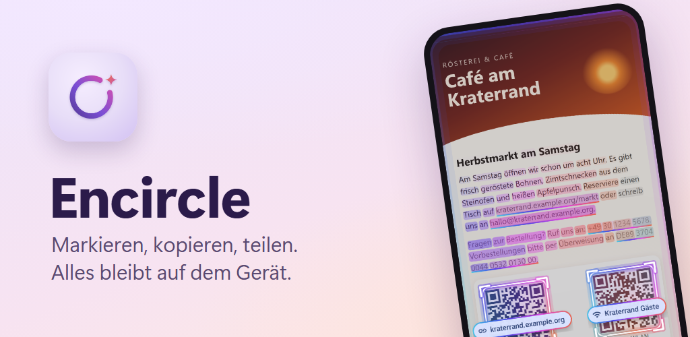

**Circle to Search, nur ohne Suche.**
Text, Links und Codes überall auf dem Android-Bildschirm markieren, dann kopieren, teilen oder öffnen. Alles bleibt auf dem Gerät.

[English](README.md)

---

Encircle meldet sich als digitaler Assistent des Handys an. Beim Aufruf (Home gedrückt halten oder die Assistenten-Geste) friert es den aktuellen Bildschirm ein und lässt dich auswählen, was du brauchst, so wie bei Circle to Search. Es schickt nichts irgendwohin: keine Suche, kein Konto, keine Internet-Berechtigung.

## Funktionen

- **Intelligente Textauswahl.** Tippen markiert ein Wort, erneutes Tippen den Satz, ein drittes Mal den Absatz. Langes Drücken markiert den Absatz. Über Text wischen markiert wie ein Textmarker, diagonal über einen Absatz nimmt den ganzen Absatz, Einkreisen nimmt alles im Kreis. Griffe passen die Auswahl an.
- **Links, Adressen, Nummern.** Links, E-Mail-Adressen, Telefonnummern und IBANs werden überall auf dem Bildschirm gefunden und unterstrichen, auch wenn sie über zwei Zeilen umbrechen oder als `name (at) example (dot) org` geschrieben sind. Ein Tippen markiert sie vollständig und bietet die passende Aktion an.
- **Alle gängigen Codes.** QR, Micro-QR, rMQR, Data Matrix, Aztec, PDF417, MaxiCode, EAN/UPC, Code 128/39/93, ITF, Codabar und GS1 DataBar werden erkannt. WLAN-Codes verbinden, Visitenkarten werden gespeichert, Termine landen im Kalender, Links öffnen sich.
- **Sauberer Text beim Kopieren.** Zeilen werden zu Absätzen zusammengeführt, Silbentrennung am Zeilenende entfernt, Listen behalten ihre Umbrüche.
- **Material You.** Dynamische Farben aus dem Hintergrundbild, hell und dunkel, lebendige und schnelle Animationen.
- **Datenschutz von Grund auf.** Die Erkennung läuft komplett auf dem Gerät, die App hat keine Internet-Berechtigung. Siehe [PRIVACY](docs/PRIVACY.md).

## Installation

Die passende APK aus dem [neuesten Release](https://github.com/Maxi2555/encircle/releases/latest) laden. Für fast alle aktuellen Handys ist das `encircle-<version>-arm64-v8a.apk`. Ab Android 10.

Wer neue Funktionen früher ausprobieren möchte, findet Beta-Versionen wie `0.2.0-beta.3` unter den [Vorabversionen](https://github.com/Maxi2555/encircle/releases). Stable und Beta sind mit demselben Schlüssel signiert, ein Wechsel geht ohne Neuinstallation.

## Einrichtung

Die Startseite der App führt durch drei Schritte, hakt jeden ab, sobald er erledigt ist, und öffnet die passende Einstellungsseite für dein Gerät. Kurz gesagt:

1. Encircle öffnen, **Assistent auswählen** antippen und Encircle als App für den digitalen Assistenten wählen.
2. In denselben Einstellungen **Bildschirm- und App-Daten verwenden** und, falls vorhanden, **Screenshot verwenden** einschalten.
3. Den Aufruf passend zum Gerät einrichten:
   - **Drei-Tasten-Navigation:** Home gedrückt halten.
   - **Gestennavigation auf GrapheneOS und anderen AOSP-Systemen:** Unter *Einstellungen › System › Navigationsmodus › ⚙* das Wischen zum Aufrufen des Assistenten einschalten, dann schräg aus einer unteren Ecke nach oben wischen. Langes Drücken auf die Leiste ist dort fest mit Circle to Search verbunden.
   - **Pixel mit Google-Launcher:** Circle to Search unter *Einstellungen › System › Navigationsmodus* ausschalten.
   - **Samsung:** Circle to Search unter *Einstellungen › Anzeige › Navigationsleiste* ausschalten.

Ohne Google-Spracherkennung (GrapheneOS, weitere Nutzer) meldet Android den Assistenten bei jedem Neustart ab, in weiteren Nutzern auch bei jedem Wechsel dorthin. Die App zeigt dann **Neu verbinden** und unter **Dauerhaft beheben** einen adb-Befehl, der das einmalig behebt. Hintergrund steht in der [englischen README](README.md#set-up).

## Mitmachen

Fehlerberichte, Erkennungsprobleme, Ideen, Übersetzungen und Code sind willkommen, gern auch auf Deutsch. Entwickelt wird auf dem Branch `beta`, siehe [CONTRIBUTING](CONTRIBUTING.md).

## Lizenz

[Apache License 2.0](LICENSE). Mitgelieferte Komponenten und ihre Lizenzen stehen in [NOTICE](NOTICE) und [THIRD-PARTY-NOTICES](THIRD-PARTY-NOTICES.md). Die Texterkennung nutzt **Google ML Kit**, das kostenlos, aber **nicht quelloffen** ist.

Encircle ist ein unabhängiges Projekt und gehört nicht zu Google. „Circle to Search“ ist eine Marke der Google LLC und wird hier nur zur Beschreibung der Bedienweise verwendet.
